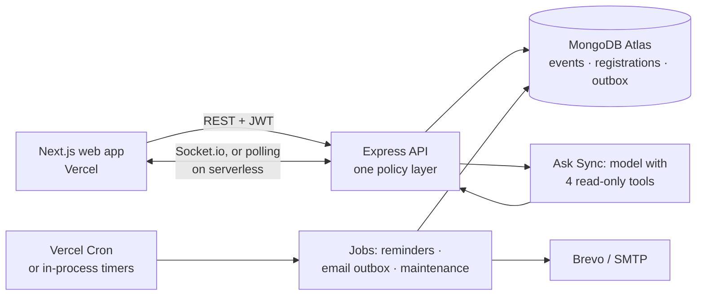

# Sync · campus plans, minus the chaos

> **Sync puts every campus event in one place: students find events, RSVP in one tap and plan their week; clubs publish events, manage waitlists and check people in at the door.**
> *One feed instead of forty WhatsApp groups.*

**Live app:** https://sync-campus.vercel.app (press **Sign in**, then a one-click **Member**, **Organizer** or **Admin** button)

---

## Why Sync

Campus events are announced in WhatsApp groups, on posters and in emails. So nobody has the whole picture:
- students miss things they would have gone to, and double-book the things they do find;
- clubs cannot tell who is coming, so a full room and an empty one look the same until the day;
- nobody owns the list, so the question "what's on this weekend?" has no answer.

Sync is the single list. Students get a feed, a calendar and a ticket. Clubs get registrations, a waitlist that runs itself and a door check-in. Admins decide which clubs may publish.

## Try it in a minute

1. Open the live app, press **Sign in** and pick the **Member** button. You are Kabir, who already has tickets, private plans, notes, event chats and unread notifications.
2. **Home** shows your tickets, events picked from your interests and the notification bell.
3. **Explore**: search, filter by category and RSVP to something. Pick an event that overlaps one you hold and you get a "clashes with…" warning (the RSVP still goes through).
4. **Schedule** is your week as a calendar, with your entry code for the next event at the bottom.
5. Press <kbd>Ctrl</kbd>+<kbd>J</kbd> and **Ask Sync**: *"What's on my calendar this week?"* or *"Any tech events this weekend?"*
6. Sign in again as the **Organizer** to see the console: a full hackathon with a waitlist, a draft, a cancelled event and a past event with check-ins.

Every account, and a script of things to try with each, is in [TEST_ACCOUNTS.md](TEST_ACCOUNTS.md).

## Features

| Screen | What it does |
|---|---|
| **Home** | Your tickets, recommendations from your interests and what's popular, and unread notifications. |
| **Explore** | Search and filter public events by category and date, sorted by soonest or most popular. RSVP in one tap; a full event puts you on the waitlist instead of turning you away. |
| **Event page** | Details, venue map, seats left, organizer, an "Add to calendar" file, the event chat and, once it has ended, a rating. Server-rendered, so a shared link shows a real preview. |
| **Schedule** | A calendar of everything you are attending, waitlisted for, organising or planned privately. Click a day to add a private plan. Your QR entry code lives here. |
| **Chats** | One chat per event, open to its attendees. Organizer announcements notify everyone going. |
| **Notes** | Personal sticky notes, optionally linked to an event; pin the ones that matter. |
| **Map** | Venues on an OpenStreetMap map, with place search. |
| **Ask Sync** | An AI assistant that answers from live event data and your own calendar, and replies with real event cards. It can only read. |
| **Organizer console** | Create, edit, publish and cancel events; stats; the attendee list with CSV export; door check-in by QR scan; and **The team**: invite co-organisers and door staff to a single event. |
| **Admin console** | Users (roles, suspension), organizer applications to approve or reject, and the queue of events members have reported. |
| **Settings** | Profile, interests, email notifications, theme and password, and where a member applies to become an organizer. |

<kbd>Ctrl</kbd>+<kbd>K</kbd> opens a command palette from anywhere in the app.

## How it works



- **The last seat goes to one person.** Taking a seat is a single conditional update: "add one to the count if it is still below capacity". There is no gap between checking and taking, so two people tapping at the same instant cannot both get in. A unique index on (event, user) stops a double tap from creating two registrations.
- **The waitlist runs itself.** When someone leaves a full event, or the organizer raises the capacity, the people waiting are moved up first come, first served, and each is notified in the app and by email.
- **A counter that repairs itself.** The attendee count is a stored number, so an RSVP never has to count registrations. If a process dies between taking a seat and saving the registration the number would drift, so a maintenance job recounts from the registrations that exist and corrects it.
- **Nobody waits on an email provider.** Emails are written to an outbox collection and the request returns at once. A background job delivers them in batches of 25, claims each row before sending so two workers never send the same email twice, retries up to five times, and picks up rows a crashed worker left behind.
- **One permission layer.** A single policy module answers "what can this person do with this event?" for every feature. Door staff can scan tickets but cannot open the attendee list, because it holds everyone's email. A hidden event returns "not found", never "forbidden". Private plans are visible to their owner only, not even to admins.
- **An assistant that cannot change anything.** Ask Sync has four tools (`search_events`, `get_my_schedule`, `get_event_details`, `get_recommendations`), each a thin read-only wrapper over the same services the app uses, so it sees exactly what the signed-in user may see. The server formats every time in the user's time zone, so the model never does time-zone maths, and it gets at most five rounds of tool calls before it must answer.
- **Entry codes carry no personal data.** A ticket is a signed token holding three ids, valid for 14 days and for one event only. The scan re-checks the live registration, so a waitlisted ticket is refused, and scanning twice says "already checked in" instead of failing. The QR encoder is written in the repository rather than pulled in as a dependency.
- **One codebase, two shapes.** On a long-running host the API holds WebSockets and runs its jobs on timers. On Vercel the same app runs as a serverless function: `/api/meta` tells the web app to poll instead, and Vercel Cron triggers the same job functions.
- **Every dependency has a fallback.** No email service: verification codes and reset links are shown on screen. No AI key: the assistant hides itself. No `BarcodeDetector` in the browser: door staff use the attendee list. Database down: `/api/health` answers 503.

## Tech stack

| Area | Choice |
|---|---|
| Web app | Next.js 16 (App Router), React 19, TypeScript |
| UI | Tailwind CSS 4, motion, FullCalendar, lucide icons, sonner. Fonts: Bricolage Grotesque, Instrument Serif, Geist, Geist Mono |
| API | Node.js, Express 5, TypeScript, zod for every request and for the assistant's tool schemas |
| Database | MongoDB with Mongoose: MongoDB Atlas in production, an in-memory MongoDB for local development and tests |
| Realtime | Socket.io, with polling on serverless hosts |
| Auth | Email and password (bcrypt), a 6-digit email code, JWT sessions, password reset by link |
| Email | A transactional outbox, delivered through Brevo's HTTP API or any SMTP server |
| AI | Any OpenAI-compatible Chat Completions API, in Ask Sync only |
| Maps | OpenStreetMap, with place search through Nominatim |
| Security | helmet, a CORS allowlist, three rate limiters (sign-in, the whole API, the assistant per user) |
| Jobs | Vercel Cron in production, in-process timers elsewhere |
| Testing | Node's built-in test runner with supertest, against an in-memory MongoDB |
| Hosting | Vercel (web app and API as two projects), GitHub Actions for CI |

## Project structure

```
client/                     Next.js web app
  src/app/                  Pages (App Router)
    (app)/                  Signed-in app: dashboard, explore, schedule, chat, notes, map, organizer, admin, settings
    events/[id]/            Public, server-rendered event page
    authentication/         Sign in, sign up, verify, forgot password
    page.tsx                Landing page
  src/components/           UI by area (events, calendar, chat, assistant, organizer, admin, landing, …) plus shared shell/ and ui/
  src/context/              Session, realtime connection and cross-page event updates
  src/lib/api/              Typed API client and shared types
server/                     Express API
  api/index.ts              Entry point on Vercel (serverless function)
  src/server.ts             Entry point on a long-running host (HTTP, Socket.io, job timers)
  src/app.ts                The Express app both entry points share
  src/modules/              One folder per feature: routes, service, schemas
    events/                 Events, registrations, seats, waitlist, check-in, ratings, staff and the permission policy
    assistant/              Ask Sync: the tool loop and its four read-only tools
    auth/  me/  admin/  organizer/  notes/  notifications/  places/  reports/  chat/  jobs/
  src/models/               Mongoose models: users, events, registrations, staff, messages, notifications, notes, ratings, reports, applications, outbox
  src/jobs/                 Event reminders, the email outbox, maintenance
  src/lib/                  AI client, mailer, email templates, tokens, calendar files, realtime, errors
  src/middleware/           Auth, validation, rate limits, error handling
  scripts/                  Demo data, seed, local in-memory database, create an admin
  test/                     API tests
.github/workflows/ci.yml    Tests, build, and a smoke test of the live site after each deploy
```

## Design

An "after dark campus" look rather than a corporate dashboard: dark by default with a warm off-white light theme, a purple brand colour and neon accents. Three devices carry it:
- **tickets**: the RSVP panel and your entry code are drawn as paper tickets, perforation included;
- **stickers**: rotated pills for category and status, and a gradient per category so an event without a photo still looks designed;
- **sticky notes**: taped, slightly tilted, in the Notes board.

Type has four voices: Bricolage Grotesque for headlines, Instrument Serif italic for the one word that matters, Geist for text and Geist Mono for dates and counts. The layout is mobile-first with a bottom dock. Status always carries text or a number, never colour alone, and motion (including the RSVP confetti) is switched off for people who ask for reduced motion.

## Test accounts

The sign-in page has one-click buttons for the first three. All accounts use the password `syncronify123`.

| Account | What it shows |
|---|---|
| `member@syncronify.dev` · Kabir | **Start here.** Tickets, private plans, notes, event chats and unread notifications |
| `organizer@syncronify.dev` · Tech & Computing Society | A full hackathon with a waitlist, a draft, a cancelled event, and a past event with check-ins and a team |
| `admin@syncronify.dev` | Users, a pending organizer application to approve, and a reported event |
| `ishaan@syncronify.dev` | On the waitlist for the full hackathon; leave it as `member@` and he is moved up |
| `rahul@syncronify.dev` | Door staff on one event: can scan entry codes, cannot see the attendee list |
| `tester1@syncronify.dev` … `tester5@syncronify.dev` | Clean accounts, for walking through as a new user |

Things to know:
- The data is 19 events with dates relative to the day it was loaded, so there is always something upcoming.
- The accounts are public and shared. Don't store anything private in them.
- To make your own account on the live app you need a real inbox: the verification code arrives by email.

The full list, the demo events and how to reset the data are in [TEST_ACCOUNTS.md](TEST_ACCOUNTS.md).

## Run it locally

Requires **Node.js 20.19 or newer**. The same commands work on Windows, macOS and Linux.

```bash
git clone https://github.com/sakshamm21/sync.git
cd sync
npm run install:all
cp server/.env.example server/.env
cp client/.env.example client/.env
npm run dev:memory
```

Open http://localhost:3000 and sign in as `member@syncronify.dev` / `syncronify123`.

No database, email service or API keys are needed. `npm run dev:memory` starts a local MongoDB in `server/.data` and loads the demo data; the first run downloads MongoDB once (about 780 MB). Without an email service, verification codes and reset links are shown on screen, so any made-up address works.

To enable optional features, edit `server/.env`:

| Feature | Variable |
|---|---|
| Your own MongoDB | `DB_URI`, then `npm --prefix server run seed` and `npm run dev` |
| Ask Sync | `AI_API_KEY`, with `AI_BASE_URL` and `AI_MODEL` (the default is Google Gemini's free tier) |
| Real email | `BREVO_API_KEY` or `SMTP_*`, plus `MAIL_FROM` |
| One-click demo buttons on the sign-in page | `NEXT_PUBLIC_SHOW_DEMO_ACCOUNTS=true` in `client/.env` |

Every variable is documented in `server/.env.example` and `client/.env.example`.

### Commands

| Command | What it does |
|---|---|
| `npm run dev:memory` | Run the API and the web app with a local database and the demo data |
| `npm run dev` | Run both against the MongoDB in `DB_URI` |
| `npm test` | API tests (123 tests) |
| `npm --prefix server run typecheck` | Type-check the API and its tests |
| `npm run build` | Build, and type-check, the web app |
| `npm --prefix server run seed` | Load the demo data; add `-- --reset` to wipe everything first (refuses to run in production) |
| `npm --prefix server run create-admin -- --email you@example.com` | Create the first admin, or promote an existing account |

## Testing

The tests drive the real Express app over HTTP against an in-memory MongoDB. They never touch a real database and never send email.

- **Events and registrations**: discovery, filters and pagination, the event lifecycle, the last seat under concurrent RSVPs, and the waitlist from leaving to promotion to notification.
- **Permissions**: shared ownership, team invites and the full role matrix, including door staff being refused the attendee list.
- **Accounts**: sign-up, verification, sign-in, password reset, suspension, sessions ended by a password change, rate limits.
- **Chat and notifications**: messages, announcements and realtime delivery over sockets.
- **Ask Sync**: tool calls, private events staying private, a missing key, provider errors.
- **Admin**: users, applications, reports, and an admin being unable to lock themselves out.
- **Hosting**: the Vercel handler, cron authorization, polling mode, CORS, health checks.
- **Demo data**: the seed is tested, so every documented account keeps working.

There are no automated tests for the web app yet; it is covered by the type-checked build.

## Deploy your own

1. Create a free MongoDB Atlas database and, for real email, a free Brevo account with a verified sender.
2. Import the repository on Vercel **twice**: one project with root directory `client/`, one with `server/`.
3. On the API project set at least `DB_URI`, `JWT_SECRET` (32 characters or more), `CLIENT_URL` (the web app's address) and `CRON_SECRET`; add `BREVO_API_KEY`, `MAIL_FROM` and `AI_API_KEY` for email and Ask Sync.
4. On the web project set `NEXT_PUBLIC_API_URL` (the API's address) and `NEXT_PUBLIC_SITE_URL` (its own).
5. Deploy, then, with `DB_URI` in `server/.env` pointing at your database, run `npm --prefix server run create-admin -- --email you@example.com` for the first admin.

`server/vercel.json` schedules the three jobs once a day, each called with `Authorization: Bearer $CRON_SECRET`:

| Job | What it does |
|---|---|
| `/api/jobs/event-reminders` | Emails attendees 24 hours before an event starts |
| `/api/jobs/email-outbox` | Delivers queued emails |
| `/api/jobs/maintenance` | Recounts attendees from the registrations that exist, and prunes old rows |

Every push to `master` deploys both projects. The workflow in `.github/workflows/ci.yml` tests every push and pull request, and after a push to `master` it waits for Vercel to finish and smoke-tests the live site.

## License

ISC.

<sub>Made by [Saksham Malhotra](https://github.com/sakshamm21).</sub>
